  <a href="https://wltziff.nl"><b>wltziff.nl</b></a> &nbsp;·&nbsp;
  <a href="https://www.linkedin.com/in/walter-argint-636b53263/"><b>LinkedIn</b></a> &nbsp;·&nbsp;
  <a href="mailto:wltcollabs@gmail.com?subject=Hello%20from%20GitHub&amp;body=Hi%20Walter%2C%0A%0AI%20found%20you%20on%20GitHub%20and%20I%27d%20like%20to%20talk%20about%3A%0A%0A"><b>wltcollabs@gmail.com</b></a>

 

<h3><a href="https://github.com/wlt1920/AxisNex">AxisNex</a></h3>

A free Windows app for controller tuning and calibration. A 15-second calibration fixes stick drift, a live before/after view shows exactly what changes, profiles can be shared as a file, and the controller's own lights and sound react to what you do. Designed, built and released end to end: installer, built-in updates and 11 languages.

C# · .NET 10 · WPF · installer and auto-updates &nbsp; **[Download →](https://github.com/wlt1920/AxisNex/releases/latest)** &nbsp; **[What's new →](https://github.com/wlt1920/AxisNex/blob/main/CHANGELOG.md)**

 

<h3><a href="https://github.com/wlt1920/wltziff-portfolio">wltziff.nl</a></h3>

My portfolio: a WordPress theme written from scratch, with page transitions, WebGL type, live Spotify, YouTube and GitHub data, reviews and privacy-first analytics.

WordPress · PHP · JavaScript · GSAP · Three.js

 

<h3><a href="https://github.com/wlt1920/wltziff-analytics">wltziff Analytics</a></h3>

A privacy-first analytics dashboard built into my site: visitor journeys step by step and a click map on the real page. No Google Analytics, no IP addresses, no third parties.

WordPress · PHP · MySQL · JavaScript

 

**[VioTaxi](https://wltziff.nl/projects/viotaxi/)** &nbsp; A fast, mobile-first website for a Dutch taxi company, with online booking and fixed tariffs. 
Client website · WordPress, custom theme

**[LVMINNA](https://wltziff.nl/projects/lvminna/)** &nbsp; A complete online store for a luxury candle brand from Groningen. 
Client store · WooCommerce, ACF

**[StemVrij](https://wltziff.nl/projects/stemvrij/)** &nbsp; A local, private AI app that splits music into vocals and instrumentals, with waveforms, a mixer and export. 
Desktop AI · React, Vite, FastAPI, Demucs

**[The World Below](https://wltziff.nl/projects/the-world-below/)** &nbsp; A horror game in Unreal Engine. 
Game · Unreal Engine

**[MOOD99](https://wltziff.nl/projects/mood99/)** and **[BAD EXIT](https://www.youtube.com/@BadExitStories)** &nbsp; My music and my YouTube stories channel. 
Music, video · produced, edited and released by me

 

**Build** &nbsp; HTML, CSS / SCSS, JavaScript, PHP, React, Node.js, Python, C# / .NET 
**Platforms** &nbsp; WordPress, WooCommerce, MySQL 
**Interface and motion** &nbsp; Figma, Tailwind CSS, GSAP, Three.js, WebGL 
**Workflow** &nbsp; Git, GitHub, AI-assisted development (Claude, Codex, ChatGPT) 
**Languages** &nbsp; Romanian (native), English (fluent), Dutch (fluent), Spanish (learning)

 

